- propositional logic
- equivalence classes
- modular arithmetic
- graph theory basics
- relations
- constructive and non-constructive proofs
- combinations
- permutations
- partitions
- pigeonhole theorem

# graphs

graphs are just another way of representing information
they consist of **nodes/vertices**, and **edges**

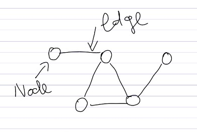

edges start at a node and end at a node, **they must have a start/end**
there can be more than one edge between two same nodes, and an edge can start and end at the same node aswell!
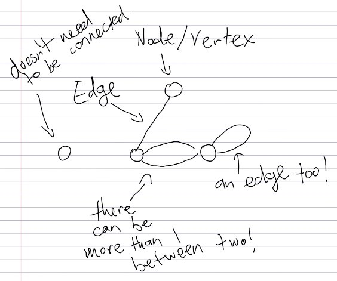

edges can also have a singular direction, which is represented as an arrow instead of a line!
graphs where edges are directed/arrows are also called digraphs (directed graphs)

when theres an arrow from node A to node B, that means node A can go to node B, but not vice versa.

nodes do not need to be connected to the rest of the graph to still be included in the graph

a graph that does not have any split up parts, or nodes that arent connected to the rest of the graph, and have only one edge between two of the same nodes, and do not have any edges that start and end at the same node, are considered simple

# relations

a relation is a subset of a cartesian product between two sets 😰😰 so scary sounding

cartesian product between two sets is what you would get if you pair every element from the first set with an element in the second set, into set of tuples of the form {(element from first set, element from second set), ...}

basically a relation is just a set of tuples, and the order of the tuple matters

for example consider the relation <= (less than or equals to)
A <= B is not the same as B <= A

our relation <= is just a set containing all tuples, where this relation is true
so for <= this would be like {(1,1,), (1,2), (2,2), (2, 3), (3,3,), (3,4), ....} etc. etc.

if an element x relates to y with some relation called R, then you can also write it as Rxy, or if you give the relation a name to use as an operator for example ~, you can also write the fact that x and y relates to eachother as x ~ y, as in the case x <= y where we gave the relationship the name <=

another way to represent relations is as a graph, where each element is a node, and the relation being represented as an edge between two elements

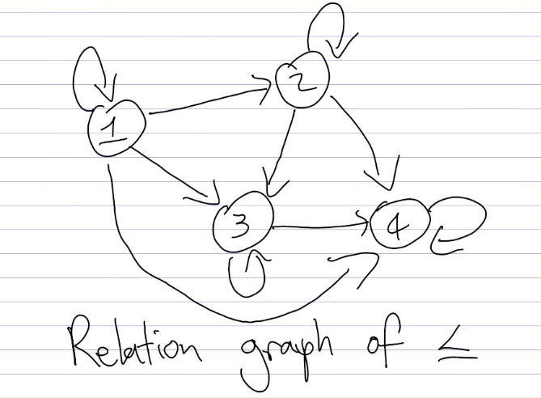

so here this would be an example of the relation <= for a set of elements that consist of just 1, 2, 3, 4
notice the directed edges (arrows), as 1 is smaller than equal to 2, but not vice versa

if 2 is smaller than or equal to 1, then we'd have an arrow from 2 to 1 instead
also notice how there are arrows going from each number back to itself, as each number is smaller than or equal to itself

# properties of relations
this brings me to some properties of relations

relations can have a couple properties, the ones we'll focus on is

- reflexivity
- symmetry
- antisymmetry and
- transitivity

## reflexivity

**iff a relation is reflexive then every element that is in the domain of the relation, is also related to itself**

you can imagine a node with an arrow that goes back to itself. so for the example of <=, it is considered a reflexive relation, as each element in the relation graph links back to itself

to remember why its called reflexivity, you can think of reflexive pronouns (myself, yourself, him/her/itself, ourselves, yourselves, themselves)

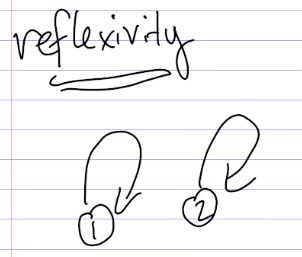

## symmetry

**iff a relation is symmetric then every relation that goes from A to B also goes back from B to A**

you can imagine an undirected edge, or two arrows from one element to the other and vice versa.

for example, the 'is classmate of' relation is symmetric, where if A is a classmate of B, then B is also a classmate of A.

in our example of <=, this relation is NOT symmetric, as 2 <= 1 is not part of the relation, but 1 <= 2 is.

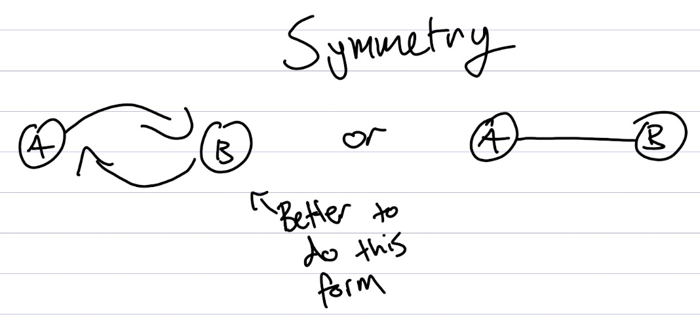

## antisymmetry

**iff a relation is antisymmetric then when theres a relation between a and b, and a relation between b and a, then a must be equal to b**

you can imagine on the graph that there can never be two arrows from one element to the other going opposite way round

antisymmetry is not the same as the opposite of symmetry!!
you can be both not symmetric and not antisymmetric either!! for example, take the relation set { (a, b), (b, a), (a, c) }. this set is neither symmetric nor antisymmetric as not all the relations can be flipped (there is no (c, a) so not symmetric, and there exists a relation that is flipped (a, b) (b, a) so not antisymmetric)

there cannot be any relations that go both ways in antisymmetry

in our example, <= is antisymmetric, as there are no relations in the set of elements that go both ways

## transitivity

**iff a relation is transitive then for every element thats related to a second element, and for every element that the second element relates to, the first element also relates to it**

this one might be more intuitive in notation form

(a,b) in R and (b, c) in R  implies  (a, c) in R
recall that being in R, means the tuple is a valid relation in the set of relations R

you can imagine this means, if a nodes on a graph go from one to another then to another, there has to be an additional edge going from the first node to the last

in our example, <= is also transitive, as it if 1 <= 2, and 2 <= 3, then 1 <= 3 aswell

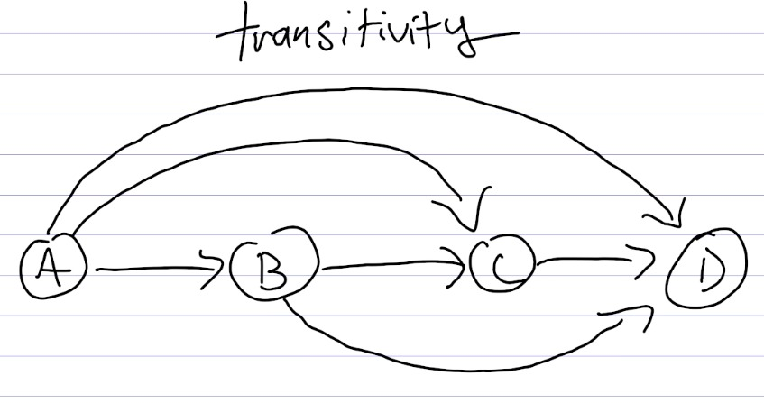

# equivalence relations and classes

an equivalence relation is a relation that is reflexive, symmetric, and transitive

so, in the relation, it has to ensure for any x, x relates to x (reflexivity)
for any x and any y, if x relates to y then y also relates to x (symmetry)
for any x, y and z, if x relates to y and y relates to z, then x also relates to z (transitivity)

a relation always acts on some set of elements, you can imagine this is like the domain

say we have a domain/ set of elements the relation acts on called S
if x is from S, lets consider a set of elements
where the elements of that set are just elements from s that relates to x with some relation, that is reflexive, symmetric, and transitive
we call this set, the equivalence class

so the equivalence class of x, is a set of elements such that the elements relate to x by some equivalence relation

any element thats part of this set, this equivalence class, can be representative as the whole set

the domain S, is just the union of all the different equivalence classes
and if we have two equivalence classes, and they are distinct to each other (different to one another), then they cannot have a common element

we can call two integers a and b congruent modulo n, if n divides a - b

we dont know whether or not the relation of congruent modulo n is an equivalence relation or not
so what we do, is we try to show that it has each property that is necessary for the relation to be an equivalence relation, namely show that it is reflexive, transitive, and symmetric

so we have to show that

- a is equal to a after applying mod n
- show that if n divides a-b, then n divides b-a
- and show that if n divides a-b and n divides b-c then n divides a-c

recall that congruent modulo n is just some relation, and relations are just sets, which can also be represented in graph form.

consider congruent modulo 3 on the set of integers from 0 to 6
in graph form it becomes something like this
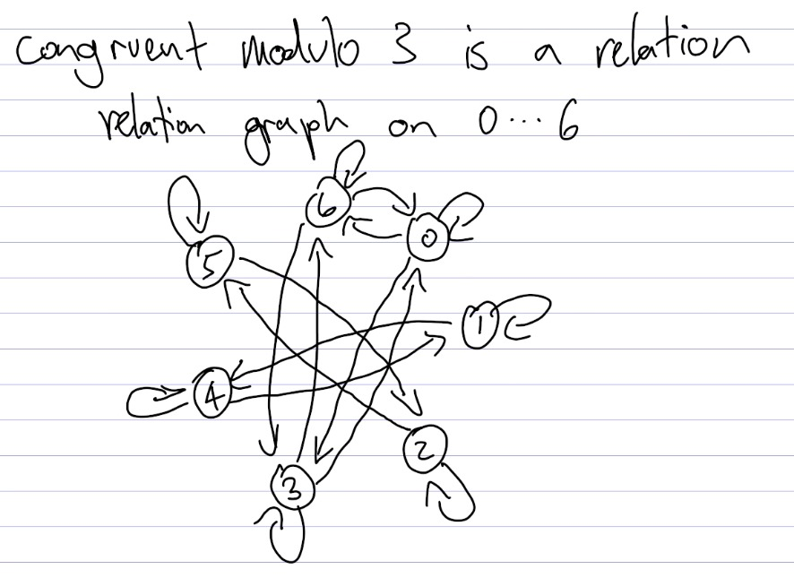

remembering that each arrow from node A to node B represents that theres a relation between A and B

here, the equivalence class of 0 (remember to draw the bar on top) would be a set of numbers {0, 3, 6} as 0 relates to 0, 3 relates to 0 and 6 relates to 0

remember the definition of equivalence class of x being just the set of elements from the domain that are equivalent to x under some equivalence relation

when the domain of the equivalence class of some x under the congruence modulo n equivalence relation is the integers

so for our example instead of S, being the domain now we set it to Z (standing for integers)

we call that the set of integers modulo n for some x, where now we can write it as x with a bar on top, standing for the set of numbers that is x + k*n where k is some integer, and n is from the integers modulo n

BOOM basic overview done!!

# combinatorics
combinatorics deal with the way you count, sort, analyse and really a lotta things now that i think about it

one of the principle of combinatorics is the rule of product, which is simple but important to know

say i have some number N of items, and another number M of items
how many different ways can i pair the first group of items to the other group?
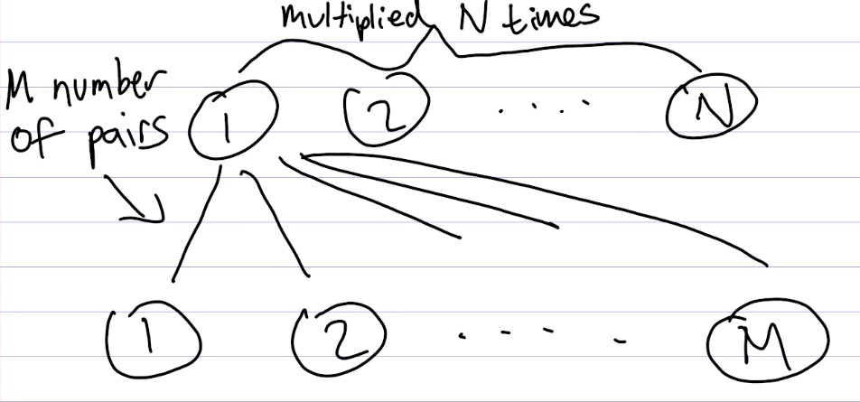

well the first item in the top group could be paired with any of the M number of items, so theres M possibilities in the first item, another M possiblities in the next, and so on so forth N times.

the number of different ways to pair the groups then becomes just N multiplied by M

say I have 5 different ice cream flavours and 3 different icecream toppings

- vanilla, green bean, rum and raisin, chocolate, strawberry
- chocolate flakes, crushed nuts, sprinkles

then there would be 15 unique ice creams combos to try and rate

ok, but what if instead of finding the possible pairs i want to order different items instead?

# permutations

say that i'm dissatisfied with the current alphabetical order, big letter has ruled over us for too long!

how many ways is there to reorder the alphabet? in other words, how many permutations are there for the alphabet? (permutations is just another word for reordering chat im just using slang)

well we have 26 characters, so the first spot could be any one of 26
now that we chose one, we only have 25 characters left to pick from for the second letter, 24 characters for the third, and so on so forth until the last letter and we've got just the one last

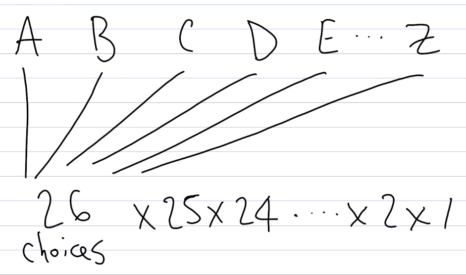

woah

another way of representing the multiplication of numbers as they decrement down is factorial!! which uses the ! at the end as an operator!

anyways, so that means, the number of unique orders i can have for the alphabet is 26! or 403291461126605635584000000

how lame that we settled for one when there are so many other choices!! big letter has played us for fools
ok but what if we get greedy here?

my favourite letter is C because C is for cheese
so lets add say 7 more Cs to our new alphabet to make 8 Cs! how fortuitous!

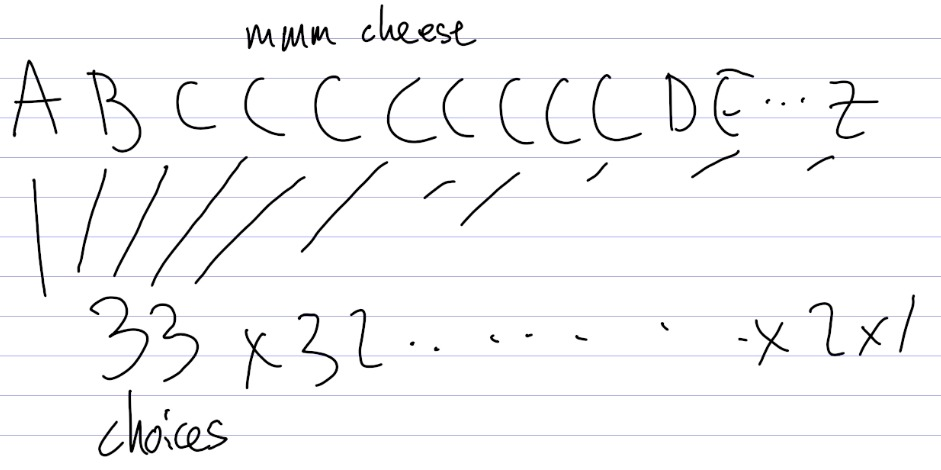

so now we have 8683317618811886495518194401280000000 rather than 403291461126605635584000000 possible orders of the alphabet!! mama mia

but wait is that really the case?

say we now have some alphabet ordering like GEFCACCBCCZC.......
if we initially labelled each of our additional Cs with numbers, it happens to be the case that we've also considered the following alphabet orderings

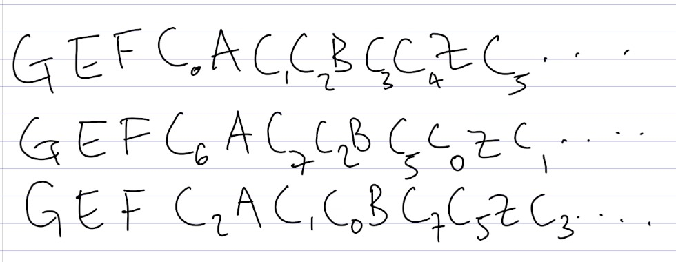

but these labels are lwk from our own cheese filled delusions 🤤 mm cheese

when in fact these orders are all the same order, but we wanted number of unique orders!!
so how many times could we have ordered around the individual Cs?

well that then just becomes a smaller permutation problem where we have 8 Cs to reorder from, so we pick the first C from the 8 we have in store, then 7, then 6 ... to get 8\*7\*6...\*2\*1

so for every possible unique ordering, right now what we've done is we're essentially multiplying that by 8! due to us thinking all the Cs are distinct when they arent! silly us!, we can fix that by dividing our current number by 8! and find that we actually only have 

215360059990374169035669504000000 instead of 
8683317618811886495518194401280000000 which is still more than 
403291461126605635584000000

man factorial gets pretty big pretty fast

anyways in fact, whats happening is to get the number of unique shuffles in any group of items, you would be dividing by the factorial of each item type, to prevent duplicates of orders, when dividing by 8! in the example, i'm neglecting the fact im implicitly also dividing by 1! 32 times for each of the other letters

# combinations
ok now that we've seen permutations, what if i wanted to get 6 different types of flowers for a pretty bouquet, and the flower shop had a good selection of 9 different flowers?

well we have 6 spots to choose from 9 flowers
so the first spot could be any flower from 9, then second is chosen from the 8 left, then third 7, etc etc until last spot left and theres only 4 flowers to choose from, so 9\*8\*7\*6\*5\*4 possible combinations of flowers

ok, so say we have some grouping, lily, daisy, tulip, .....
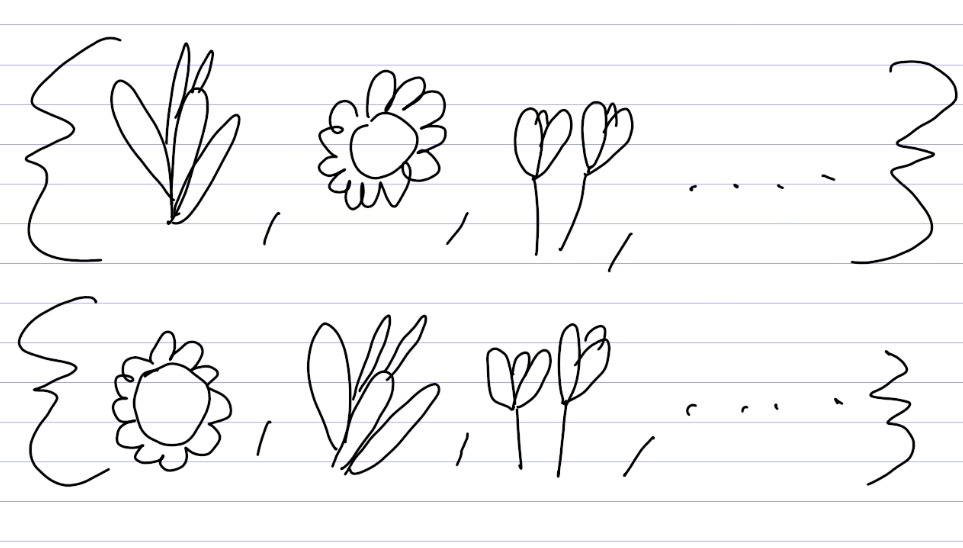
its also possible in our calculations that we have another possible group being daisy, lily, and tulip

but the types of flowers chosen hasnt changed, just the ordering, which we don't care about!!
so what we can do, is calculate how many possible ways we can permute (reorder) the group of flowers we're going to choose, in order to figure out how many times we accidentally duplicated the number of possible combinations

well, we have 6 flowers, so 6! ways of ordering them assuming theyre all unique

so we just do 9\*8\*7\*6\*4 divided by 6!

in general, given n items in total, and we're trying to choose k items

to derive this we can take inspiration from our flower example and see
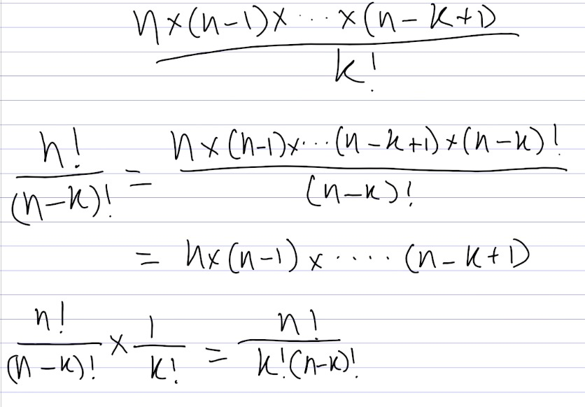

a more simplified calculation friendly formula is n!/(k! * (n-k)!)

we call this function, the choose function. as we are *choosing* a certain k number of objects from n total objects. when using this function we'd say something like n choose k

# partitions

ok so now that we have this tool to use
lets try and figure out what to do if we have a number of bags, and a good bunch of gold bars to put inside the bags

say we only brought 3 bags having busted into the bank unprepared and theres a good 10 bars of gold

how many possible ways could i split the gold between the 3 bags?

heres one way i could do it

say, instead of putting them directly into the bags, we put 2 dividers between the bars of gold so that theres 3 groupings of gold neatly formed so as to sweep them right into our bags in one fell swoop

so now we have 10 bars of gold alongside 2 extra dividers to consider
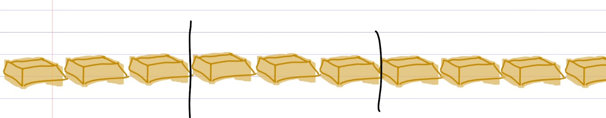

ou shiii but now we can just think of this like a combinations problem

we have 12 spaces to choose from, and we just gotta choose either 2 spots from the spaces to put our dividers with the rest of the spaces being the gold bars by default, or choose 10 spots to put our gold in, with the 2 other spaces being the dividers by default

doesnt matter which one you choose to think about, but for me ill think about it in the picking two spots to put our dividers in way

so then this just becomes, 12 choose 2, so 12! / (2! * 10!) = 66 possible ways to split the gold between the bags

ok nice! now that we're rich, we can go buy the flowers we wanted for our bouquet and take big letter head on with our new alphabet order proposal!! if we're lucky and succeed we can reward ourselves with 1 of 15 unique icecream combos!!

# pigeonhole principle

but shit, we're on the run!! the feds figured us out after we tried to liquidate all our gold and caused prices to be a little more bearish that day causing traders everywhere to seethe in unexpected stop loss hits!!

we're 3 people strong, so long as there arent an equal amount of feds that catch us, we'll be fine!! i'm certain!!!

say we run while being chased by 9 met officers into a nice surburban road lined with a good 4 detached houses and decide to break in and hide inside of one

but is it certain, that we would be fine?

well no, as there are 9 officers, if each are assigned to a house, there will be 2 in each house, with one more having to decide to go in one have the 4 houses, resulting in a house that could end up having 3 officers

and so, by the pigeonhole principle, we might not be fine afterall

the pigeonhole principle essentially states

given that we have n pigeons that are to be placed into m holes, where theres less pigeons than holes, so n < m, then at least one hole must contain atleast the ceiling of n/m

some very cool stuff comes from this! such as 

## hair doppelganger
given 100,000 hairs is on a persons head on average, and we dont consider bald people

and say there is 11 million people in london, it is by the pigeonhole principle, that there has to be people with the same amount of hair on their head

in fact, there has to be atleast 11 mil / 100,000 ceiling-ed, so per hair count, 110 people would have the same amount in london

# lossless compression
another one is

say someone has claimed they have created a lossless compression algorithm that can take in ANY file and can compress it into 80% of its original size!

is this possible?
well lets see

say we have a file thats 32kilobytes, so 256,000 bits

how many possible files could we have from 256,000 bits?

well we have 256,000 spots to pick for bits, and each bit we choose either 0 or 1, so its 2 to the power of 256,000

ok, but after compression, the file size must be 204800 bits

so theres only 2 to the 204800 possible files of that size

by the pigeonhole principle, there must be a compressed file that was compressed into that by more than one uncompressed file, which means this is a non-injective mapping (scary words to say we dont know how dafuck we can uncompress this file to get the original file)

and so it is impossible for there to be a lossless compression algorithm that can take in any file and compress it to 80% of its original size

the pigeonhole principle is simple in principle, but can get very weird to use, when needing to consider what can be considered pigeons and what can be considered holes, its all very abstract

one style of questions is take this for example

# two elements sum to ten

prove that any subset of size six from the set S = {1,2,3,...,9} must contain two elements that sum exactly to 10. note that the 2 elements may be the same thing twice

this is tricky to think about... whats the pigeons? whats the holes?

well there are six elements that the subset has to have so that seems like a likely candidate for pigeons, but what about the holes?

ok what if we group up the set S into pairs that sum up to 10?

{1, 9} {2, 8} {3, 7} {4, 6} {5}

ok, so now we have five pairs, and six numbers, so by the pigeonhole principle there must be one pairing where two of our chosen numbers land on, and so QED.

# challenge: distance of two darts 

ok given a square with side length of 1

you get to throw 5 darts onto the square, and say that you always land onto the square

prove that there must always be two darts whose distance apart is less than or equal to half of root 2

first things first, what are the pigeons and what are the holes?

for pigeonhole principle, always find a group of N number of things that can be labelled/ placed into a M number of categories/ spaces such that N is strictly smaller than M

a hint for this question is, how can you split up the space where darts can be thrown?